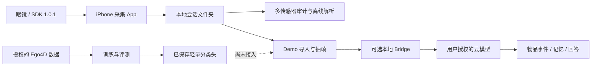

# 系统与数据流

## 入口与边界

`apps/ios`：Swift 采集与 UI。核心是 RoboMemoGlassesCameraViewModel、RoboMemoMultiSensorController、RoboMemoSensorRecorder、RoboMemoVideoRecorder。普通录像与多传感器模式的时间轴行为不同，修改时要分别回归。

`apps/demo`：Node 本地服务和浏览器界面；随包 observations 与媒体为虚构。自动分析会将用户选中的帧送给可选 bridge，不会因为启动 demo 就自行分析录像。

`services/bridge`：实验性账号连接，运行状态在本地创建。它不是任意供应商通用接口；真实账号可用性不属于离线测试保证。

`training/fho`：独立的离线研究流程。输入授权数据、弱标签与分组划分；输出模型、评分和聚合比较。模型接收特征向量，不能把 MP4 直接传给分类头；视觉编码与预处理必须匹配训练配置。

## 多传感器会话文件

| 文件 | 内容 |
|---|---|
| `video.mov` | H.264，无内嵌声音；多传感器按视频 SDK 相对 PTS 写入 |
| `frames.csv` | 每帧原始尺寸、源 PTS、手机到达时间、输出 PTS、写入结果 |
| `audio.wav` | 实际收到的 PCM16 音频块按顺序拼接，不按时间缺口插入静音 |
| `audio_chunks.csv` | 块时间、格式、WAV 样本/字节偏移和结果；空块也有诊断 |
| `motion.csv` | 加速度、陀螺仪、可用姿态等、SDK ns 与手机到达时间 |
| `device_state.csv` | 电量/佩戴/镜腿/温度等状态变化；无 SDK 时间时留空 |
| `session.json` | 请求配置、模块状态、重试、同步测试、错误与诊断 |

关闭音频时仍保留 WAV 空头和 CSV 表头，模块为 disabled。音频/IMU 失败不会主动丢弃视频，但会话必须结合模块状态判读。

所有手机到达时间取自 CMClockGetHostTimeClock。Motion 到达时间是在 AsyncStream 消费处读取，不是 SDK 内部收包时间。视频/音频 SDK PTS 属于设备媒体时钟；与手机时钟不同。Motion 的单调 ns 与媒体 PTS 的统一原点/速率映射未确认，禁止直接相减后当成同步结果。

开发模式、实验 API 边界和真实字段说明以 [iOS 文档](../apps/ios/README.md) 为准。
